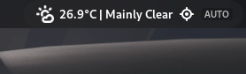

# Advanced Weather Companion GNOME Shell Extension

## Overview

Advanced Weather is a feature-rich GNOME Shell extension that provides detailed and customizable weather information right on your desktop. With support for multiple locations, advanced forecasting, and beautiful visualizations, this extension transforms how you interact with weather data.


## Features

- 🌦️ Real-time weather updates
- 📍Auto-location detection
- 🌡️ Detailed temperature and feels-like information
- 💨 Wind speed and direction
- 💧 Humidity and precipitation forecasts
- 🌈 Dynamic weather icons
- 🌐 Multiple weather data providers
- 🎨 Customizable appearance and units
- 🗺️ Location search
- ⚠️ Real-time Weather Alerts

## Installation

### From GNOME Extensions Website
1. Visit [GNOME Extensions](https://extensions.gnome.org/)
2. Search for "Advanced Weather Companion"
3. Toggle the switch to install

#### Manual installation

Install from source

- Download the archive file from the releases tab
- Open a terminal in the directory containing the downloaded file
- Install and enable the extension by executing `gnome-extensions install extension.zip --force` in the terminal

> To set up your manual location by giving your location coordinates in the settings in the extension or in the Location settings in the main menu of the extension, you can get your location coordinates from Google Maps by going to your location and right-clicking on in it and copying the location coordinates from it by clicking them

https://github.com/user-attachments/assets/706925f5-410c-473c-af72-099fc4096503


## Screenshots

### Weather Widget in home screen


### Main Interface


### Hourly Forecast Interface


### Daily Forecast Interface


## Weather Insight Interface

## Features

- Real-time weather updates with current conditions
- Hourly and daily forecasts
- Smart weather insights with temperature trends and probability of precipitation
- Automatic location detection with an option to input coordinates manually
- Support for Celsius and Fahrenheit
- UI with animated elements for smoothness.

## Weather Data Display

- Current weather: Temperature, conditions, wind speed


## Location settings


## Refresh button Interface


## Configuration
### Weather Widget configuration in settings


Right-click the weather widget to access:
- Location settings
- Unit preferences (Celsius/Fahrenheit)
- Update interval
- Weather provider selection

### Provider fallback and offline data (Weather Provider page)
- **Try Other Providers On Failure** — when a provider fails, the next one is tried; every provider is used at most once per refresh
- **Fallback Priority** — reorder the attempt order with the ↑ / ↓ buttons; the selected provider is always tried first
- **Use Cached Data Up To** — how many days the last successful forecast may be reused
- **Cached Forecast** — shows what is stored right now (source, age, stored hourly/daily points) and can be cleared

When every provider fails — for example while offline — the extension reuses the last successful fetch, including the hourly and 7-day forecasts, as long as it is still within the cache window and its forecast covers today, instead of showing an error. Reused data is marked with ♻️ and keeps its original timestamp. A refresh also paints the cache first, before any request goes out, so a stalled location lookup or a provider that hangs until the request timeout cannot leave the panel blank or stuck on an error.

#### Where the cache lives

The cache is stored in the extension's own gsettings schema (dconf), not in a file, so it survives shell restarts and is inspectable from a terminal:

| Key | Type | Contents |
| --- | --- | --- |
| `cached-weather-data` | `s` | the whole last successful payload as one JSON string |
| `weather-cached-at` | `x` | its `fetchedAt` as Unix seconds, mirrored so `dconf`/`gsettings` can see the age without parsing JSON |
| `weather-cache-max-age-days` | `i` | user-set reuse window (preferences → Weather Provider) |

```bash
# point gsettings at the schema shipped with the extension
export GSETTINGS_SCHEMA_DIR=~/.local/share/gnome-shell/extensions/advanced-weather@sanjai.com/schemas
gsettings get org.gnome.shell.extensions.advanced-weather cached-weather-data | jq .
gsettings get org.gnome.shell.extensions.advanced-weather weather-cached-at   # date -d @<value>
gsettings set org.gnome.shell.extensions.advanced-weather cached-weather-data '{}'   # clear it
```

#### What is inside

```jsonc
{
  "providerKey": "openmeteo",            // which adapter produced this
  "provider": "Open-Meteo (Free)",       // label shown in the menu, " (fallback)" / " (cached data)" appended
  "fetchedAt": 1762000000,               // Unix seconds of the successful fetch
  "location": "Chongqing, China", "lat": 29.56026, "lon": 106.55771,
  "stale": false,                        // set on load when served from cache
  "current": {                           // Open-Meteo field names, metric
    "temperature_2m": 21.4, "apparent_temperature": 20.1,
    "relative_humidity_2m": 63, "surface_pressure": 1013,
    "weather_code": 2,                   // WMO code → icon + label via getWeatherConditions()
    "wind_speed_10m": 8.4, "wind_direction_10m": 210
  },
  "hourly": { "time": ["2026-11-01T14:00", ...], "temperature_2m": [...], "weather_code": [...], "precipitation_probability": [...] },
  "daily":  { "time": ["2026-11-01", ...], "temperature_2m_max": [...], "temperature_2m_min": [...], "weather_code": [...] }
}
```

`hourly` and `daily` are `null` for providers that do not ship a forecast (OpenWeatherMap, WeatherAPI, most custom endpoints), so the panel shows only current conditions for those.

#### Time keys: one format, so the cache is queryable

Every `time` array in the cache uses the same two shapes, regardless of provider:

| Axis | Format | Example |
| --- | --- | --- |
| hourly | `YYYY-MM-DDTHH:MM`, local wall clock | `2026-11-01T14:00` |
| daily | `YYYY-MM-DD` | `2026-11-01` |

Providers are asked for the **forecast location's own** clock (`timezone=auto` for Open-Meteo, `timezone=local` for Meteosource; wttr.in is local by definition), and each adapter passes its `time` array through `canonicalTime()` in `lib/providers.js` on the way in: ISO stamps with an offset or seconds are stripped to wall clock, epoch seconds and epoch milliseconds are converted to local date-times, daily axes are collapsed to the date part, and a value that is neither (`"2026-13-45"`, `"today"`) becomes `null` instead of being stored as a mystery date. A cache written by an older build, which kept raw epoch values, is still read correctly: the panel re-normalizes each entry before it looks up a day or an hour.

That makes the stored payload directly queryable — "what will tomorrow look like" is a calendar lookup on the key, not a guess:

```bash
CACHE=$(gsettings get org.gnome.shell.extensions.advanced-weather cached-weather-data | jq -r .)
TOMORROW=$(date -d tomorrow +%F)

# the day row for tomorrow, index-aligned across the daily series
echo "$CACHE" | jq --arg d "$TOMORROW" '
  .daily as $daily
  | ($daily.time | index($d)) as $i
  | { date: $d, max: $daily.temperature_2m_max[$i], min: $daily.temperature_2m_min[$i], code: $daily.weather_code[$i] }'

# the first stored hour that is still ahead of now — plain string comparison
# works because the keys are zero-padded and in local wall-clock order
echo "$CACHE" | jq --arg now "$(date +%Y-%m-%dT%H:%M)" '
  .hourly as $h
  | ([$h.time | to_entries[] | select(.value >= $now)][0]) as $e
  | { hour: $e.value, temperature: $h.temperature_2m[$e.key] }'

# how the cache will be labelled in the menu
echo "$CACHE" | jq '{providerKey, fetchedAt, stale, hours: (.hourly.time | length), days: (.daily.time | length)}'
```

#### How the data is normalised

There is **one** provider table, `WEATHER_PROVIDERS` in `lib/providers.js`; `extension.js` and `prefs.js` both import it, so the dropdown, the request URL, the parser and the fallback chain cannot disagree. Each entry is `{ name, description, baseUrl, requiresApiKey, isFree, rateLimit, supportedParams, buildUrl(), parseResponse() }`.

Every adapter ends in a `parseResponse()` that maps the vendor payload onto the Open-Meteo field names above, converts to metric on the way in — the Weather Underground / custom branch turns `imperial.temp` (°F) into °C and `windSpeed` (mph) into km/h, so the cache is always metric — and normalizes its time axes as described above (an Open-Meteo-shaped body is passed through with its `time` arrays re-written). Conversions for *display* are applied at render time in `lib/panelMenu.js` — `use-fahrenheit` for temperature and `convertWindSpeed()` (`wind-speed-unit`: `kmh`, `ms`, `mph`, `knots`) for wind — so a single cache entry can be re-rendered in any unit without refetching.

Two guards decide whether a cached entry may be shown:

- **Age** — `fetchedAt` (falling back to `weather-cached-at`) must be inside `weather-cache-max-age-days`, and a payload without any forecast must be younger than a day. A stamp up to a day *ahead* of the wall clock — an NTP step or a manual backward correction — still counts as fresh; further ahead than that, the stamp cannot be trusted and the cache is refused.
- **Forecast horizon** — the last `daily.time` entry must still cover today. ISO dates (`2026-11-01`) are used by the built-in providers; custom endpoints commonly emit epoch seconds (9–10 digits) or milliseconds (12–13), which are normalised to dates as well. A day list that cannot be read as a date is not trusted as a horizon, so the age rule decides.
- **Coordinates** — a payload whose `lat`/`lon` is more than ~1 km from the current location is discarded instead of being shown for the wrong city.

**Test Connection** on the Weather Provider page asks the same adapter the panel uses, for the location the panel will use (manual coordinates, else the cached ones), and reports the temperature parsed out of the response. A green test therefore means the panel can read that endpoint, not merely that the endpoint answers.

## Requirements

- GNOME Shell 45+
- Internet connection
- One of the supported weather APIs:
  - OpenWeatherMap
  - WeatherAPI
  - AccuWeather

## Troubleshooting

### Common Issues
- No weather data displayed
  - Click the refresh button 🔄
  - Check your internet connection
  - Restart GNOME Shell (Alt+F2, then type 'r')

[](https://extensions.gnome.org/extension/7603/advanced-weather-companion/)


[](https://github.com/Sanjai-Shaarugesh/Advanced-Weather)


## Contributing

### Reporting Issues
- Check existing issues
- Provide a detailed description
- Include GNOME Shell version
- Attach screenshots if possible

### Development
1. Fork the repository
2. Create a feature branch
3. Commit changes
4. Push and create a Pull Request

Run the test suite locally:

```bash
node test/run-tests.mjs
```

It syntax-checks the sources, verifies that `schemas/gschemas.compiled` and every `locale/*/*.mo` were regenerated from their sources, checks that `locale/advanced-weather.pot` still matches the strings used in the code, and exercises the provider fallback chain, the offline cache, the panel rendering and the preferences wiring (Node 20+, no dependencies).

After touching those inputs, regenerate them:

```bash
glib-compile-schemas schemas     # after editing schemas/
./translations.sh --all          # after adding or changing a _("…") string
```

`--all` re-extracts the template, merges it into every `.po` and recompiles the `.mo` files. Strings with no translation fall back to English, so the extension stays usable while translators catch up.

## Uses
This extension is using `ipapi.co` and `open-meteo.com` services

## License

MIT License - See [LICENSE](LICENSE) for details

## Donations

Support the development:

[](https://buymeacoffee.com/sanjai)

**Thank you for your support!**
# Please forgive me for my bad documentation 😅


**Star ⭐ my   repository if you find it useful!**
